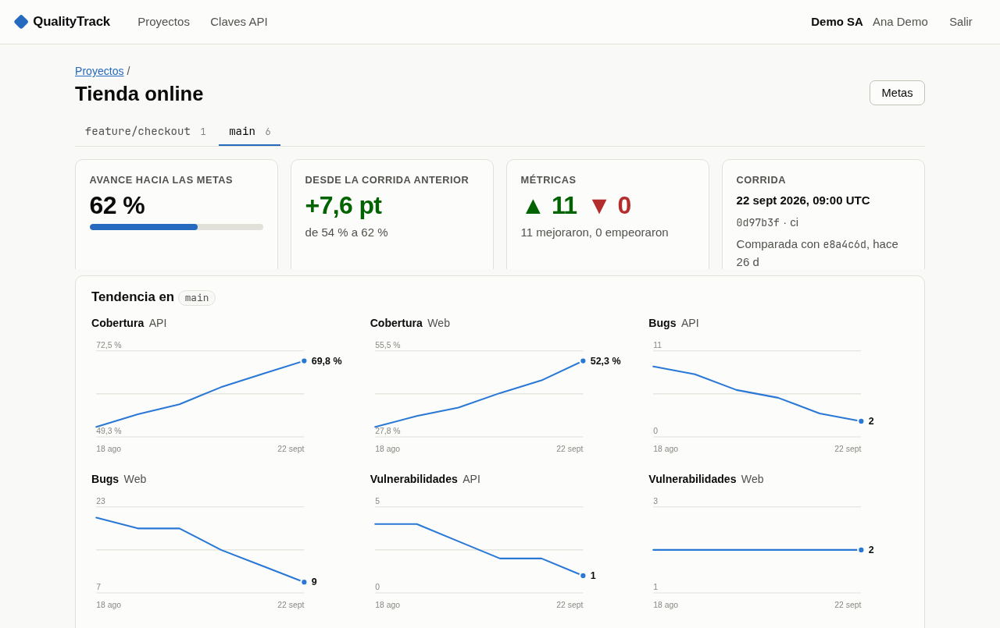

# QualityTrack

Historial de calidad para cualquier aplicación. Cada vez que corren los tests y el análisis de código,
el pipeline (o un script local) reporta la corrida; QualityTrack la guarda con su rama y commit, y muestra
en un dashboard qué cambió desde la corrida anterior y cuánto se avanzó hacia las metas.

- **Datos por organización:** proyectos, usuarios y claves API pertenecen a una organización y toda consulta se limita a ella.
- **Agnóstico de la herramienta:** recibe un JSON con métricas numéricas. Sirve con SonarQube, con un reporte
  de cobertura o con cualquier número que el equipo quiera seguir.
- **Avance medible:** cada métrica puede tener una meta; el avance es el tramo recorrido entre el valor
  inicial y la meta, y el del proyecto es el promedio de sus metas.



## Licencia en breve

QualityTrack es **código disponible, no código abierto**. Es propiedad intelectual de
[Santiago Almeida](https://github.com/santiagoalmeida).

| Quién | Uso |
|---|---|
| Desarrolladores independientes con ingresos de hasta USD 10.000 al año | Gratis, también en proyectos comerciales propios |
| Cualquiera, para evaluarlo | Gratis durante 30 días, fuera de producción |
| Empresas y organizaciones, o personas por encima de ese umbral | Licencia comercial, negociada con el autor |

Los términos completos están en [LICENSE](LICENSE). Para una licencia comercial, escribe a Santiago Almeida
desde su [perfil de GitHub](https://github.com/santiagoalmeida).

## Arrancar

Requiere .NET 10.

```bash
dotnet run --project src/QualityTrack.Web    # http://localhost:5210
```

La primera visita lleva a **Configuración inicial**, donde se crea la organización y su administrador.
Después, en **Claves API**, se crea la clave con la que se reportan las corridas.

La base de datos es SQLite (`qualitytrack.db`, junto al ejecutable) y las migraciones se aplican al arrancar.
Para cambiar su ubicación: `ConnectionStrings__QualityTrack="Data Source=/ruta/qualitytrack.db"`.

Con Docker:

```bash
docker build -t qualitytrack .
docker run -p 8080:8080 -v qualitytrack-data:/data qualitytrack
```

La aplicación sirve HTTP; en producción va detrás de un proxy que termine TLS.

## Reportar una corrida

```bash
curl -X POST http://localhost:5210/api/v1/runs \
  -H "X-Api-Key: $QUALITYTRACK_API_KEY" \
  -H "Content-Type: application/json" \
  -d '{
    "project": "mi-app",
    "projectName": "Mi aplicación",
    "branch": "main",
    "commit": "a1b2c3d",
    "dirty": false,
    "source": "ci",
    "components": [
      {
        "key": "backend",
        "name": "Backend",
        "tests": { "total": 120, "passed": 118, "failed": 2, "skipped": 0 },
        "metrics": { "coverage": 61.5, "bugs": 3, "vulnerabilities": 1 }
      }
    ]
  }'
```

| Campo | Notas |
|---|---|
| `project` | Clave estable del proyecto (minúsculas, dígitos, `.`, `_`, `-`). Se crea con la primera corrida. |
| `branch` | Las comparaciones se hacen siempre contra la corrida anterior de la misma rama. |
| `commit`, `dirty`, `source`, `executedAt` | Opcionales. `dirty` marca corridas con cambios sin commitear. |
| `components[]` | Partes medidas por separado (backend, frontend…). Cada una lleva `tests`, `metrics` o ambos. |
| `metrics` | Clave → número. Las del catálogo reciben nombre, unidad y meta; cualquier otra se guarda igual. |

La respuesta (`201`) trae el avance tras la corrida y el de la anterior:

```json
{ "runId": "…", "project": "mi-app", "branch": "main", "projectCreated": false, "progress": 0.47, "previousProgress": 0.41 }
```

### Métricas del catálogo

`quality_gate` (1 = pasa), `coverage`, `line_coverage`, `branch_coverage`, `bugs`, `vulnerabilities`,
`security_hotspots`, `code_smells`, `technical_debt_minutes`, `duplicated_lines_density`, `open_issues`,
`reliability_rating`, `security_rating`, `maintainability_rating` (1 = A … 5 = E), `lines_of_code`, y las de
tests (`tests_total`, `tests_passed`, `tests_failed`, `tests_skipped`, `tests_duration_seconds`), que salen
del objeto `tests`.

La primera vez que un componente reporta `coverage`, `bugs`, `vulnerabilities`, `tests_failed` o
`duplicated_lines_density` se le asigna una meta por defecto (80 %, 0, 0, 0 y 3 %). Se cambian o se quitan
en la página **Metas** del proyecto.

## Arquitectura

```
src/
  QualityTrack.Domain          Entidades, catálogo de métricas y cálculo de avance. Sin dependencias.
  QualityTrack.Application     Casos de uso: ingesta, dashboard, metas, claves API, cuentas.
  QualityTrack.Infrastructure  EF Core (SQLite), migraciones, hash de contraseñas.
  QualityTrack.Web             Blazor (render estático en servidor), API de ingesta, autenticación.
tests/
  QualityTrack.Tests           xUnit sobre SQLite en memoria.
```

Las dependencias apuntan hacia adentro: Web → Infrastructure → Application → Domain.

- Las mediciones se guardan en formato "largo" (corrida, componente, métrica, valor): una métrica nueva no
  requiere migración.
- Toda consulta lleva el id de la organización del usuario o de la clave API.
- Las claves API se guardan como hash SHA-256 y solo se muestran al crearlas; las contraseñas, con PBKDF2.

```bash
dotnet test
dotnet ef migrations add <Nombre> -p src/QualityTrack.Infrastructure -s src/QualityTrack.Web -o Persistence/Migrations
```

## Hoja de ruta

- Invitar usuarios y roles por proyecto (hoy cada organización tiene solo el administrador que la creó).
- Alta de más organizaciones en una misma instalación (hoy la crea la configuración inicial).
- PostgreSQL o SQL Server como proveedor, para instalaciones con varias instancias.
- Alertas cuando una corrida empeora, e insignias de estado para el repositorio.

## Autor

© 2026 Santiago Almeida. Todos los derechos reservados. Consulta [LICENSE](LICENSE).
